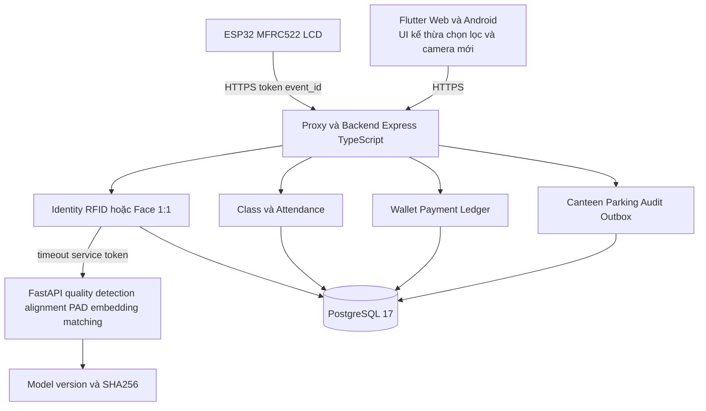
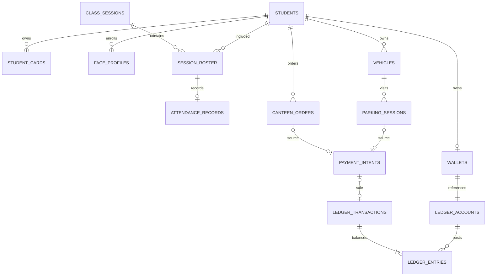
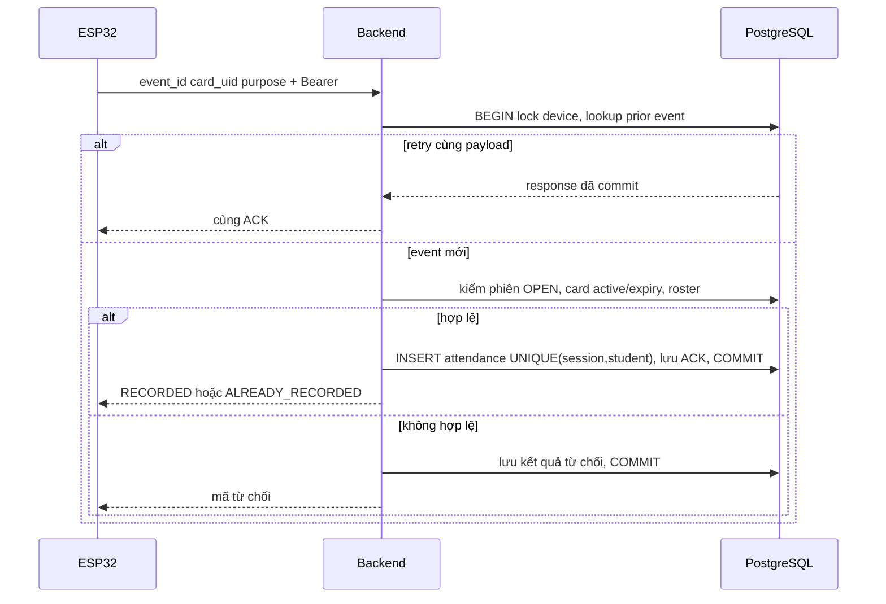

# Kiến trúc mục tiêu và phạm vi prototype

Thiết kế kế thừa Express/TypeScript, Flutter và ESP32 của TapCard. PostgreSQL thay toàn bộ Mongoose; AI nội bộ là phần bổ sung. Hai widget Flutter được dùng lại trực tiếp, các provider chưa được chuyển API. Blueprint này chưa phải hệ thống đã triển khai.

Backend chia module trong một ứng dụng để transaction nghiệp vụ dùng chung DB. AI trả evidence, không ghi ví. Template Face mã hóa trong DB, key giữ ngoài DB; capture chỉ giữ theo consent/retention. Prototype hiện chỉ có RFID attendance; Face chưa có PAD và luôn từ chối cấp VERIFIED.

ERD rút gọn; ledger account có thể không thuộc wallet (tài khoản căn tin/nguồn tiền mô phỏng). SQL database/001.sql là căn cứ FK/check thực tế, gồm typed FK nguồn thanh toán và unique theo nguồn. Check/trigger chưa thay thế authorization, posting amount/account kind, cache balance và reversal service cần làm tuần 4.

Use Case và sơ đồ ví bản trước nằm ở diagrams/tham-khao-image*.png, trích nguyên từ báo cáo 02/11. Bản thiết kế chi tiết, vai trò, 28 ca gốc và lịch 8 tuần nằm trong THIET_KE_THAM_KHAO_02_11.md; mọi kết quả test lịch sử ở đó phải đối chiếu evidence mới.
