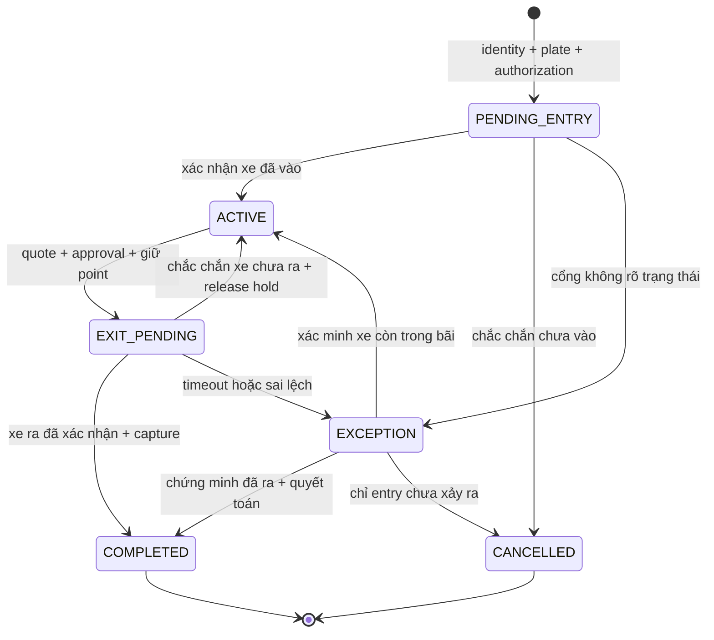
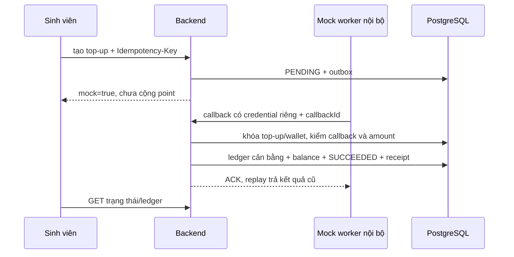

# Luồng nghiệp vụ và state machines

> Thiết kế đã được người dùng duyệt ngày 05/11/2026. Đây là tài liệu thiết kế gốc; xem [trạng thái triển khai](implementation-status.md) và [runbook](SETUP_SMART_CAMPUS.md) cho code, lệnh chạy và bằng chứng hiện hành.

Thiết kế 0.1, 05/11/2026, chờ duyệt. API chi tiết ở [api-contracts.md](api-contracts.md); ràng buộc SQL ở [database-design.md](database-design.md). Mọi tác động mô phỏng vẫn qua application service và transaction thật trong DB thử nghiệm.

## 1. Định danh, thẻ và một reader đổi role

1. ADMIN xác nhận sinh viên, tạo enrollment context có TTL, gắn reader role RFID_ENROLLMENT. Scan thật tạo assertion một lần; admin xác nhận gán. UID đã active cho người khác bị từ chối, không tự chuyển chủ thẻ.
2. Báo mất do STUDENT áp dụng ngay LOST, revoke assertion/approval chưa dùng; cấp lại do ADMIN, thu hồi thẻ active cũ và cấp thẻ mới trong một transaction. Payment đã POSTED giữ nguyên lịch sử.
3. Device config có version và role. ADMIN đổi role chỉ khi không có context/command/challenge chưa giải quyết; revoke context cũ, tăng version, firmware GET config và ACK trước scan mới. Body tự khai role không đổi quyền backend.
4. PARKING_ENTRY, PARKING_EXIT, CANTEEN_POS và RFID_ENROLLMENT là bốn role phần cứng MVP. Điểm danh Face DEMO dùng virtual device `ATTENDANCE_CAMERA` ở simulator, không đòi thêm reader. RFID attendance prototype được giữ làm nguồn tham khảo, không phải thêm role ngầm.
5. Cùng reader lần lượt demo enrollment → entry → POS → exit; không giả lập nhiều đầu đọc vật lý. Nếu có pending exit không xác minh được, không đổi role để bỏ qua lỗi.

Scan pipeline: authenticate device → lookup event cũ → nếu mới kiểm challenge/config/time → normalize/HMAC UID → kiểm card/student → tạo identity assertion gắn purpose/context/device/expiry (đề xuất 60 giây) → domain xử lý tiếp. Assertion không là authorization chi tiền và chỉ consume cùng transaction tạo thao tác; duplicate event lấy lại cùng kết quả, không consume lần hai.

Mất mạng: giữ payload/eventId trong RAM qua tối đa 3 retry có backoff; không nhận thêm scan khi còn pending. Khi hết retry, LCD yêu cầu kiểm trạng thái; qua reset mất RAM thì tra pending action theo device ở server trước scan mới. Không tự phát lại hành động vật lý hoặc chi tiền. Challenge mới chỉ dùng cho lần scan mới.

## 2. Vào bãi

1. Nhân viên tạo entry context gắn parkingLot/reader. Thẻ thật hoặc Face DEMO hợp lệ cho identity assertion; kiểm active student/consent theo method.
2. Nhân viên nhập/chọn plate trên OCR DEMO: server chuẩn hóa uppercase và bỏ space/dấu phân cách cho so sánh; không tự thay O↔0 hoặc nhận mọi plate là hợp lệ. Lưu rawText, normalizedPlate, confidence, source, evidenceRef. Low confidence/không đọc được yêu cầu review.
3. Tìm vehicle theo plate, kiểm authorization còn hiệu lực; sửa OCR phải có before/after/reason và actor. Sửa OCR không đồng nghĩa cấp phép xe chưa đăng ký.
4. Trong transaction khóa vehicle, kiểm occupancy và capacity bãi, chọn policy version, consume assertion, tạo PENDING_ENTRY + occupancy + gate command + audit/outbox. Unique occupancy ngăn hai lượt cùng xe kể cả hai SV dùng chung.
5. Worker gửi commandId cố định đến SimulatedGateProvider. ACK OPENED chưa là xe đã vào; staff phải xác nhận passage trên dashboard có nhãn mô phỏng. Xác nhận → ACTIVE, server ghi enteredAt và thông báo.
6. Command thất bại chắc chắn chưa mở/xe chưa vào → CANCELLED, giải phóng occupancy. Timeout không rõ đã mở → EXCEPTION, giữ occupancy đến khi staff xác minh.

## 3. State machine gửi xe

EXCEPTION có `exceptionPhase=ENTRY|EXIT`, `vehicleInside=UNKNOWN|YES|NO`, payment/command liên quan. Không cho mọi EXCEPTION chuyển tùy ý; application guard kiểm phase và bằng chứng. Nếu xe đã ra mà chưa capture do DB lỗi, giữ EXIT_PENDING/EXCEPTION và occupancy cho đến reconcile, không tạo lượt mới che lỗi.

## 4. Ra bãi và cổng lỗi

1. Staff chọn active session sau scan/Face; phải thuộc đúng student. Nếu SV có nhiều xe trong bãi, chọn session rồi scan được bind vào đúng session, không chọn ngẫu nhiên bản ghi đầu.
2. OCR exit đối chiếu plate entry, vehicle và authorization. Sai/unknown → không mở; staff có permission có thể xác minh và tạo override có lý do/evidence. Không sửa entry evidence gốc.
3. Tính quote từ policy version đã chọn lúc vào, server time, pass/discount còn hiệu lực theo quy tắc snapshot. Quote có TTL 120 giây, amount và rateVersion cố định. Hết TTL trước reserve phải báo giá/xác nhận lại; sau reserve không tự tăng phí do cổng chậm.
4. Phí >0: tạo payment request gắn quote/cycle cho sinh viên xem số point và xác nhận PIN/app trên app của mình. RFID UID hoặc Face DEMO không đủ. Phí 0: vẫn cần identity và entitlement/waiver đã kiểm, không tạo payment/hold/ledger entry delta=0; entry/exit events vẫn lưu quyết toán miễn phí.
5. Transaction khóa session → payment → tài khoản theo UUID; kiểm available point, daily limit, quote/approval, consume approval, tạo wallet hold và payment AUTHORIZED, session EXIT_PENDING, gate command/outbox. Không gọi cổng trong transaction.
6. Đủ điều kiện cổng mới nhận command. Simulated gate trả OPENED/FAILED/UNKNOWN; staff xác nhận PASSAGE_CONFIRMED gắn command/session. Transaction capture hold → balanced PARKING_PAYMENT ledger + cached balance + payment CAPTURED + session COMPLETED + release occupancy + notification/outbox. Retry chỉ trả receipt cũ.

| Trường hợp | Xử lý tài chính | Xử lý session/cổng |
| --- | --- | --- |
| Thiếu point | Không hold/debit; trả available/required/shortfall | ACTIVE; top-up rồi báo giá lại nếu quote hết hạn |
| Command chắc chắn thất bại, xe chưa ra | Release hold, payment VOIDED | Về ACTIVE; command cũ bị fence/revoke, muốn thử lại tạo attempt mới |
| Timeout, không biết đã mở hay xe đã qua | Giữ hold; không capture hoặc auto-release chỉ vì hết TTL | EXIT_PENDING/EXCEPTION; staff đối soát, không tự mở lại |
| OPENED nhưng chưa xe qua | Giữ hold, chờ xác nhận; không coi ACK mở là biên lai | Không COMPLETED |
| Xe đã qua, DB capture lỗi | Retry capture cùng payment/source ID; không gọi cổng lại | Worker khôi phục từ event passage bền vững; báo EXCEPTION quá hạn |
| Đã capture nhưng staff xác minh xe chưa ra | Reversal toàn bộ tham chiếu gốc, có quyền/lý do | Xác minh/fence command; giữ occupancy, tăng settlementCycle có audit mới được về ACTIVE và báo giá/xác nhận lại; không tự charge lại |
| ACK/passage đến sau void/reversal | Không tự debit lại, không âm thầm đóng phiên | Tạo EXCEPTION và người có quyền quyết định; event cũ không revive command |

Đề xuất cảnh báo UNKNOWN sau 30 giây, escalated review sau 5 phút. Hold chờ gate đã dispatch **không tự hết hạn**; chỉ hold chưa dispatch mới có thể release theo TTL. Để không khóa point vô thời hạn, staff có màn reconcile theo tuổi, nhưng quyết định vẫn dựa trên chứng cứ xe qua/chưa qua và lệnh cũ đã hết khả năng chạy. Camera/barrier thật tương lai cần cơ chế xác nhận passage tương ứng.

Mỗi session mặc định settlementCycle=1; retry cùng cycle chỉ được capture một lần. Chỉ resolution full reversal do chứng minh xe chưa ra mới được mở cycle kế tiếp; partial refund không cho phép thu phí lại. Scan/card lost/user locked trước authorization chặn thanh toán mới; khi hold đã AUTHORIZED và gate đã dispatch thì không tự release vì card bị khóa sau đó: xử lý passage/reconciliation theo số point đã được phê duyệt, không cho authorization mới.

## 5. Biểu phí cấu hình

Policy version bất biến có effectiveFrom/To, mode PER_VISIT/PER_HOUR/PER_DAY, unitPoints, graceMinutes, rounding, dailyCap, timezone và discount rules. Hour dùng thời lượng thực; day định nghĩa rõ block 24h hoặc calendar day qua config, không tự suy đoán. Monthly pass là entitlement student/vehicle/lot có hạn; quote ghi passId và hiệu lực đã áp dụng. Policy không chồng hiệu lực cùng scope/priority; activate policy có khóa scope và audit.

Seed thử nghiệm: 3.000 point/lượt, hoặc 2.000/giờ làm tròn lên sau grace 10 phút, cap 10.000/ngày; đây là dữ liệu synthetic để test, không biểu phí thực của trường. Không ghép mọi mode trong một lượt nếu không có rule rõ. Test 0 phút, đúng biên grace, 59/60/61 phút, qua nửa đêm, cap, monthly expiry và policy đổi trong khi xe đang gửi.

## 6. Ví point và top-up mock

Top-up PENDING → SUCCEEDED/FAILED/CANCELLED/EXPIRED. Callback có provider transaction ID unique; cùng ID khác amount/body bị chặn và audit. Callback sau cancelled/expired không tự cộng: chuyển REVIEW_REQUIRED để staff/provider đối soát. Mock worker chỉ chạy dev/test với service credential; sinh viên chỉ yêu cầu hoặc chọn scenario mô phỏng qua endpoint được phép, không được tự gọi trusted callback. Gateway thật sau này phải xác minh signature, transaction status, amount/currency/order và replay server-to-server trước posting.

Posted balance = tổng signed ledger entries của tài khoản sinh viên. Available = posted − tổng holds ACTIVE. Kiểm available dưới khóa wallet; credit/debit hai phía và balance cache nằm cùng transaction. TOP_UP đối ứng tài khoản nguồn thử nghiệm; nguồn này có thể âm theo loại account, tài khoản SV thì không. Ledger không UPDATE/DELETE; refund/reversal là posting mới. ADMIN_ADJUSTMENT cần permission/reason và tài khoản đối ứng rõ ràng.

Payment: CREATED → AWAITING_CONFIRMATION → AUTHORIZED → CAPTURED; CREATED/AWAITING → CANCELLED/EXPIRED; AUTHORIZED → VOIDED nếu chắc chắn chưa hoàn tất; CAPTURED có tổng hoàn tách riêng NONE/PARTIAL/FULL, lịch sử thu vẫn CAPTURED. Parking giữ hold giữa AUTHORIZED/CAPTURED; cantin reserve/capture trong cùng transaction sau approval. Một payment attempt đã void không tái sử dụng, source nghiệp vụ ngăn capture nhiều attempt.

Refund: khóa original transaction và tài khoản, kiểm tổng đã hoàn + amount <= original amount, post REFUND hoặc REVERSAL một lần theo refundId, audit. MVP cho refund toàn bộ hoặc phần point theo item/quantity của cantin; phí gửi xe reversal toàn bộ khi xác minh lỗi. Không có nút “xóa giao dịch”.

## 7. Cantin POS, kho và approval

1. Staff tạo order từ productId/quantity; server kiểm active/giá, snapshot giá+version, khóa inventory theo productId tăng dần, reserve đủ tồn. Không tin `unitPrice/total/studentId` từ POS.
2. Order DRAFT → AWAITING_PAYMENT; reservation đề xuất 5 phút, server tính total; sửa item tạo orderVersion mới và revoke approval cũ.
3. Scan RFID thật ở CANTEEN_POS gắn order context, hoặc Face DEMO có permission. Server xác định student; identity assertion dùng một lần. App SV nhận nội dung đơn, device, expiry và amount; SV xác nhận PIN/app.
4. Transaction khóa order → payment → inventory tăng dần → wallet/account tăng dần; kiểm version/reservation/approval/card/student active và limits; atomic charge, inventory onHand−qty/reserved−qty, SALE inventory movement, order COMPLETED, receipt/audit/outbox. Bất kỳ lỗi nào rollback tất cả; không COMPLETED khi thiếu point/kho.
5. Cancel/expiry khóa order rồi inventory và release reservation đúng một lần. Worker expiry và checkout cạnh tranh cùng khóa; bên thắng quyết định, không vừa bán vừa release.
6. Refund cần quyền, original payment và item quantity; partial refund không vượt item đã bán trừ đã hoàn. Refund stock chỉ cho hàng nhận trả được, do staff xác nhận riêng; hàng không trả được vẫn có thể refund point theo quyền nhưng không cộng kho giả.

Order: DRAFT → AWAITING_PAYMENT → COMPLETED; DRAFT/AWAITING → CANCELLED/EXPIRED. Refund status NONE/PARTIAL/FULL tách khỏi COMPLETED để giữ lịch sử. Stock invariant `0 <= reserved <= onHand`; available stock = onHand−reserved.

## 8. Điểm danh giáo viên mở phiên

1. GV chọn lớp/schedule mình phụ trách. Backend kiểm active term/class, time window, room, virtual camera device binding; tạo SCHEDULED nếu cần, khóa lớp/device rồi OPEN; snapshot roster và lateAfter. Không tự đóng phiên người khác để mở mới.
2. Simulator có permission chọn fixture student/scenario/session/device. Server dùng DemoCamera/Face/Liveness; unknown/low confidence/PAD fail bị reject trước attendance service. `source=DEMO` lưu xuyên suốt.
3. Service khóa session, kiểm OPEN/time window/roster/room/device/consent fixture; server receivedAt > lateAfter là LATE, bằng ngưỡng là PRESENT. Unique `(session_id,student_id)`; lặp trả record cũ, không sửa PRESENT thành LATE.
4. GV đóng phiên: khóa cùng session như event ingestion; event đã xử lý trước close được ghi, event nhận sau close bị từ chối. Lần close tạo ABSENT cho roster chưa có, chuyển CLOSED và outbox trong transaction. Không dựa timestamp client để backdate.
5. Điều chỉnh thủ công có reason/actor/before/after; chuyển EXCUSED hoặc sửa trạng thái qua record + append-only correction history + audit. Sinh viên chỉ gửi yêu cầu; GV có quyền phê duyệt. Huỷ phiên CANCELLED không tạo ABSENT, không xóa record trước đó; report đánh dấu phiên hủy.
6. Realtime chỉ phát room của GV lớp đó và SV tương ứng sau commit. Reconnect GET snapshot với version/cursor; event bus không phải cơ sở duy nhất để tính attendance/report.

## 9. Consent và dữ liệu sinh trắc học

DEMO không thu ảnh/embedding thật. Fixture consent thể hiện nghiệp vụ và luôn ghi synthetic. Khi thật: consent theo purpose/version; revoke chặn nhận diện tương lai, thu hồi assertion pending, lên lịch xóa template/object, ghi `erasedAt` khi đã xóa và kiểm backup retention. Lịch sử nghiệp vụ/audit tối thiểu được tách khỏi ảnh/template để xóa biometric không phá FK hay ledger. Thời hạn lưu thật cần trường phê duyệt trước triển khai.
